# OhMyTranslate

**Translate and rewrite any text you can select.**

Select text in any app and tap **Translate**. OhMyTranslate opens with your languages and writing tools one tap away, and the result streams in. Tap **Replace** and it lands back in the text field.

## Gallery

Screenshots from the UI tour, regenerated by CI on every push to `dev/*`. More notes in [docs/gallery](docs/gallery/README.md).

Screenshots from the UI tour (`OhMyTranslateUITests`), regenerated by CI on every push to `dev/*`.
The full list with notes is in [docs/gallery](docs/gallery/README.md).

<!-- gallery:start -->
|   |   |   |   |
|:-:|:-:|:-:|:-:|
| 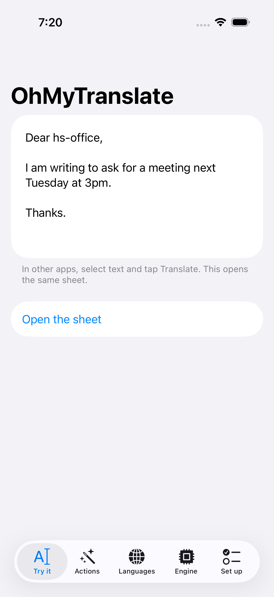 | 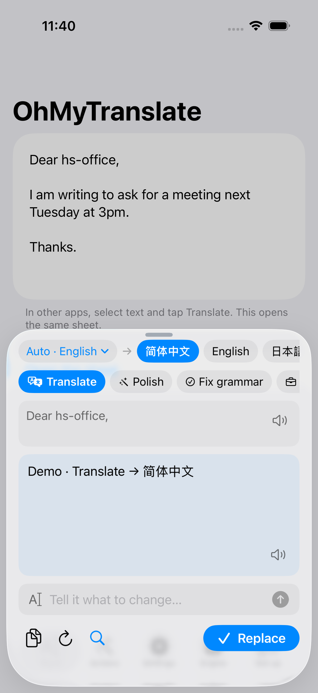 | 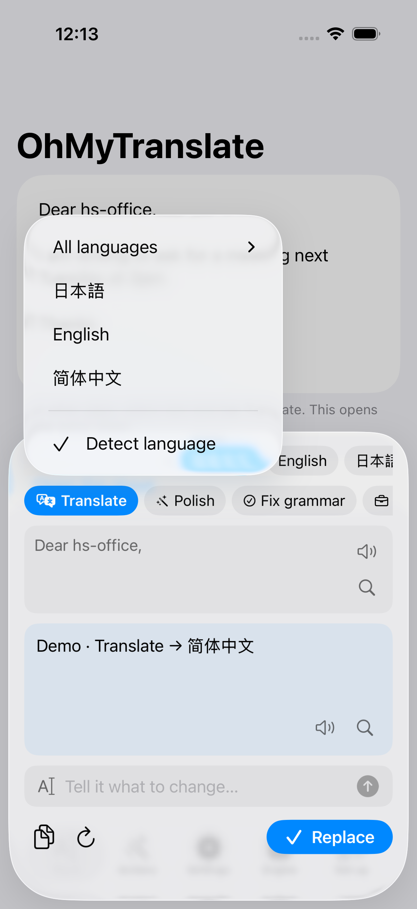 | 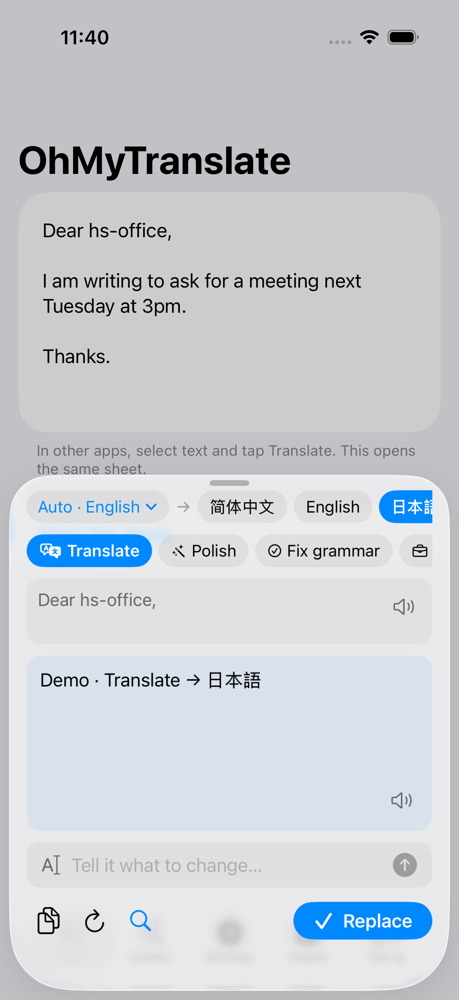 |
| **Try it: the app with sample text** | **Translate opens the sheet, language detected** | **Source language: detect, or pick one** | **Tap a language: it runs again** |
| 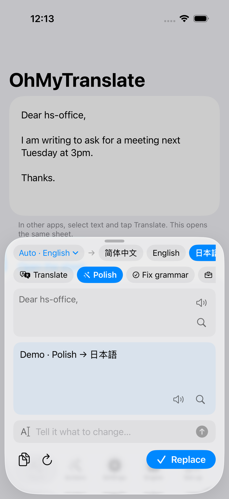 | 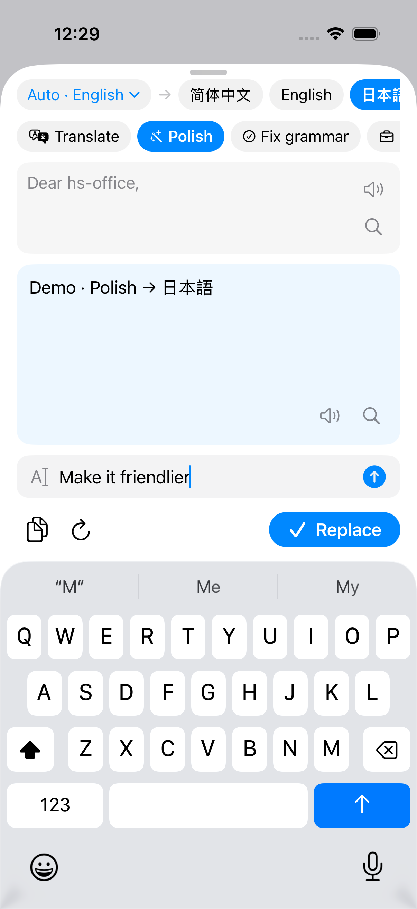 | 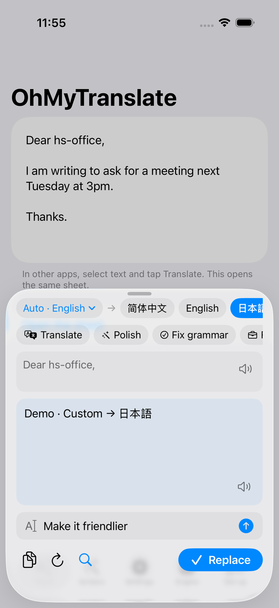 | 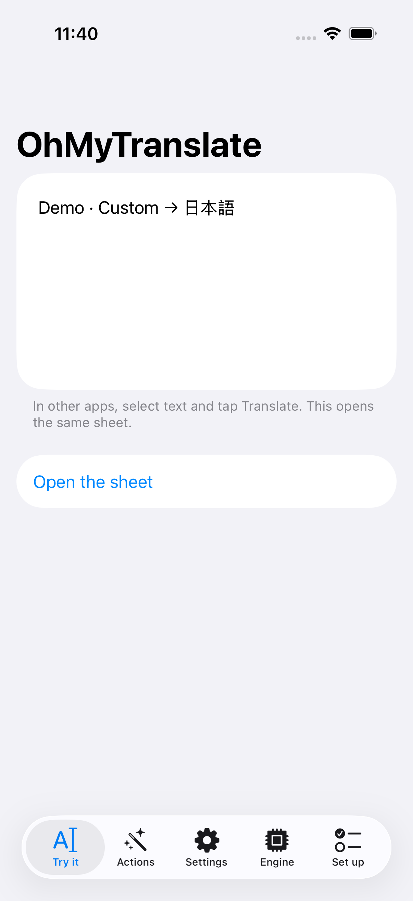 |
| **Tap an action: Polish, same text** | **Quick prompt: say what to change** | **The quick prompt's result, streamed** | **Replace writes it back into the text** |
| 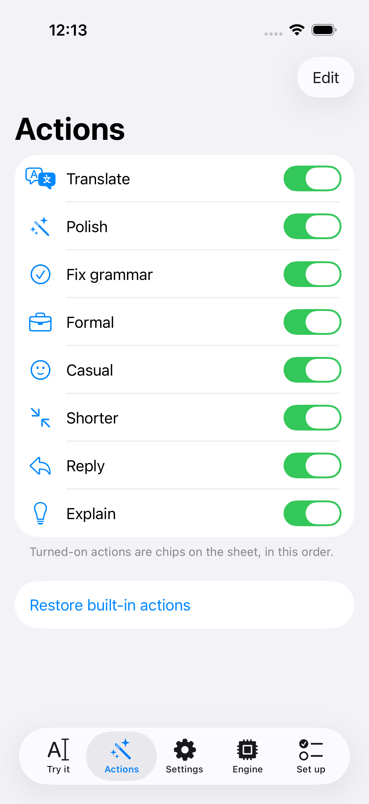 | 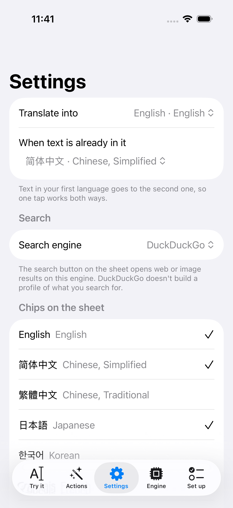 | 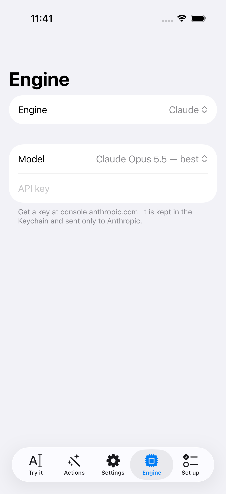 | 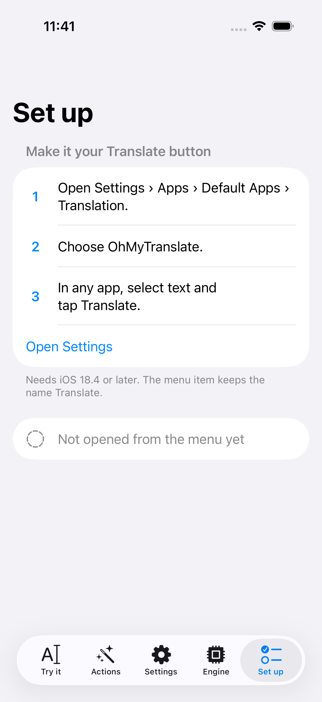 |
| **Actions: which chips show, and their order** | **Settings: languages and the default search** | **Engine: Claude, OpenAI-compatible, on-device or demo** | **Set up: make it the default Translate** |
<!-- gallery:end -->

## Engines

| Engine | Where text goes | Needs |
|---|---|---|
| **Claude** (default, `claude-opus-5-5`) | Anthropic's API | Your API key |
| **OpenAI-compatible** | The server you enter: OpenRouter, DeepSeek, Ollama, LM Studio… | Server address, model, optional key |
| **On this device** | Nothing leaves the phone | iOS 26 and Apple Intelligence |
| **Demo** | Nothing is sent; fixed answers | Nothing |

## Privacy

- No accounts, no sign-in, no analytics, no tracking. There is no OhMyTranslate server.
- Text leaves your iPhone only when you tap an action, and only to the engine you chose. Before that happens, the app asks you to allow it.
- Your API keys are kept in the Keychain. **Settings › Your data › Erase all data** removes everything.
- Full details: [Privacy policy](docs/PRIVACY.md) · [Terms of use](docs/TERMS.md) (draft, pending legal review)

## Status

Release candidate for **1.0.0**, iPhone only. See [docs/RELEASE.md](docs/RELEASE.md) for the App Store checklist and what is still needed before submission.

- **Working:** the Translate menu sheet, auto-detected source with a manual override, target and action chips, quick prompts, Replace and Copy, read-aloud for the source and the result, search on the source and the result (DuckDuckGo or Google, web or images), the Claude, OpenAI-compatible, on-device and demo engines, consent, and the settings.
- **Not yet:** agent mode for longer writing jobs, an editor for your own actions, and Apple's offline translation as an engine.

## Build and test

Requires Xcode 26 and [XcodeGen](https://github.com/yonaskolb/XcodeGen).

```sh
swift test --package-path Packages/OhMyTranslateKit   # unit tests
scripts/ci-test.sh                                     # build app and extension, run UI tests
scripts/build-ipa.sh                                   # unsigned device .ipa
```

GitHub Actions (`.github/workflows/ios.yml`) runs all of these on every push.

On a device, set your team on both targets, and enable the **Translation**, **App Groups** (`group.com.jstdlee.ohmytranslate`) and **Keychain Sharing** capabilities when Xcode asks.

## Support

Found a bug or have an idea? [Open an issue](https://github.com/jstdlee/mytranslate/issues).

## Layout

| Path | What |
|---|---|
| `OhMyTranslate/` | The app |
| `TranslateExtension/` | The extension the Translate menu opens |
| `Packages/OhMyTranslateKit` | Prompts, providers, settings, and the sheet (`OhMyTranslateKit`, `OhMyTranslateUI`) |
| `OhMyTranslateUITests/` | UI tour with the demo engine, which produces the gallery |
