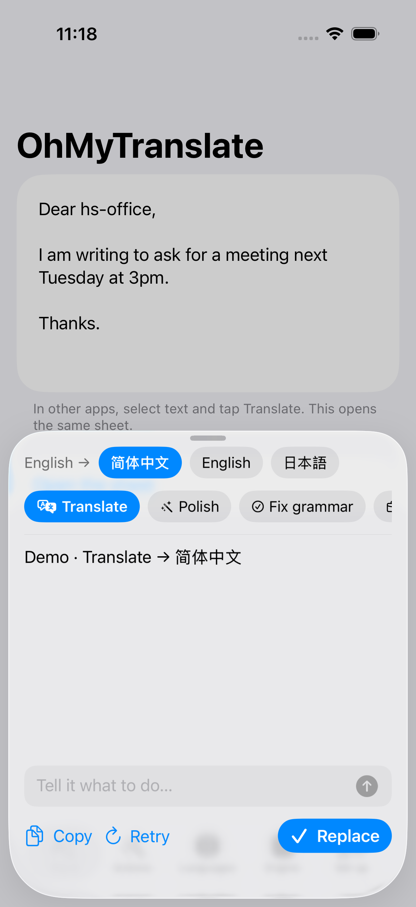
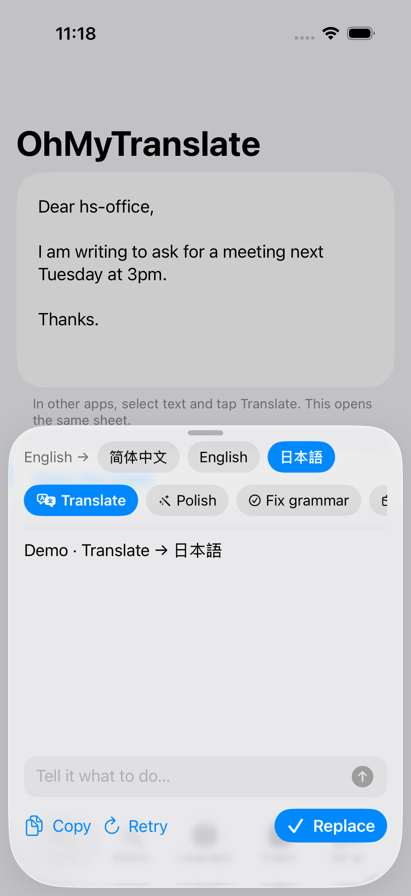
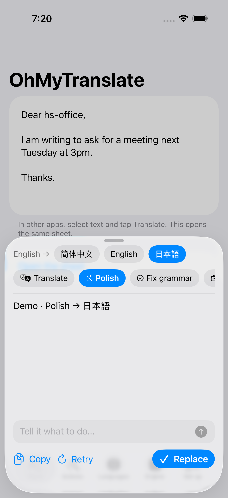
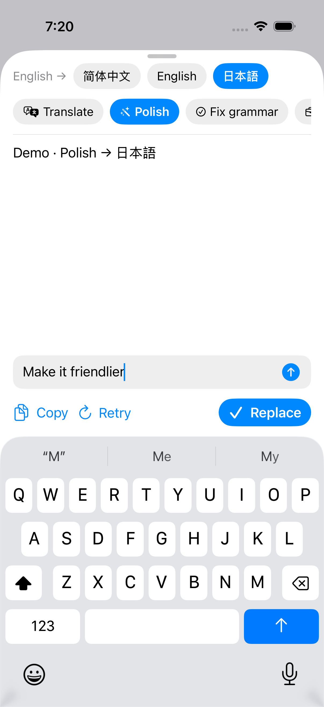
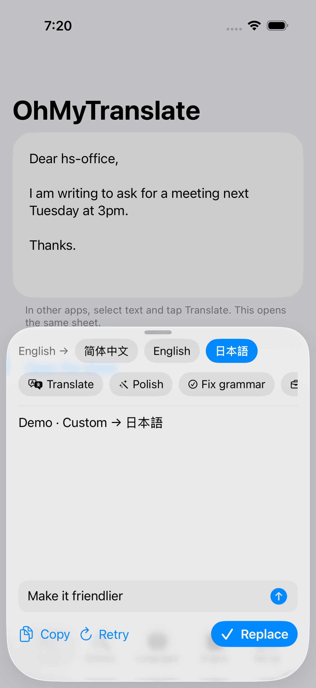
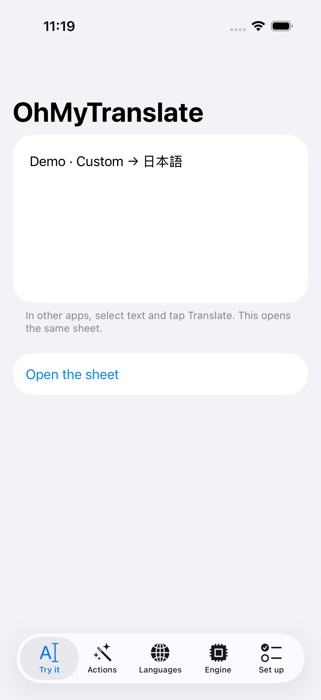
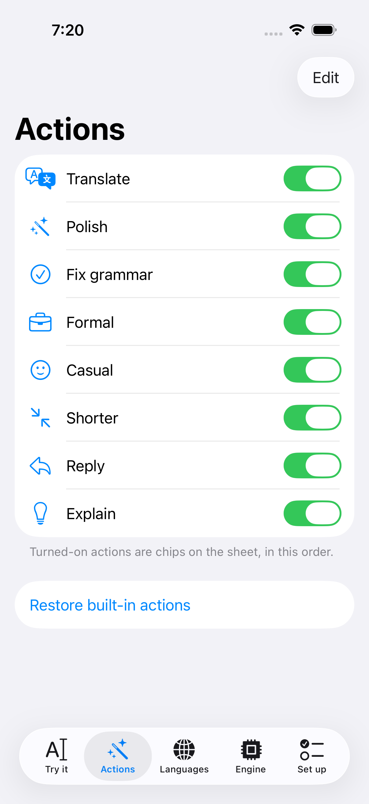
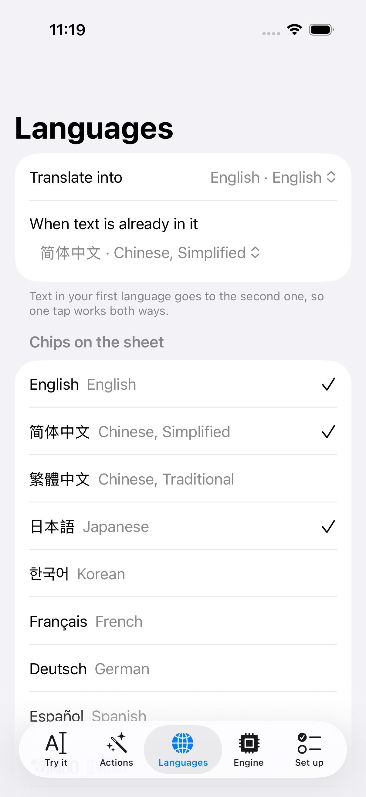
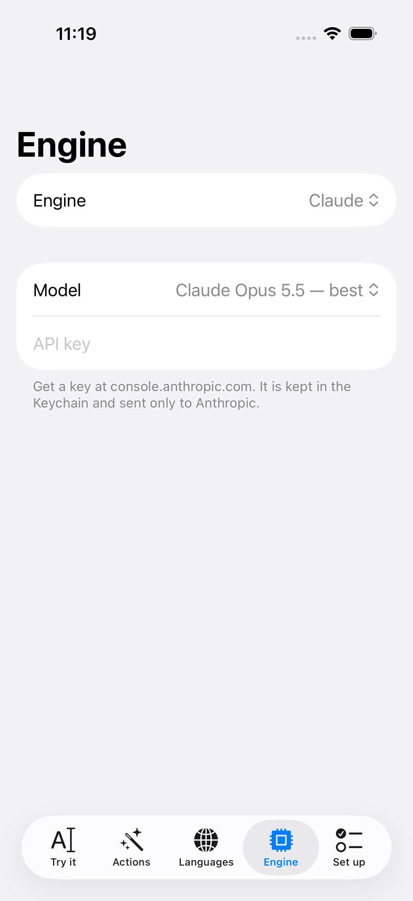
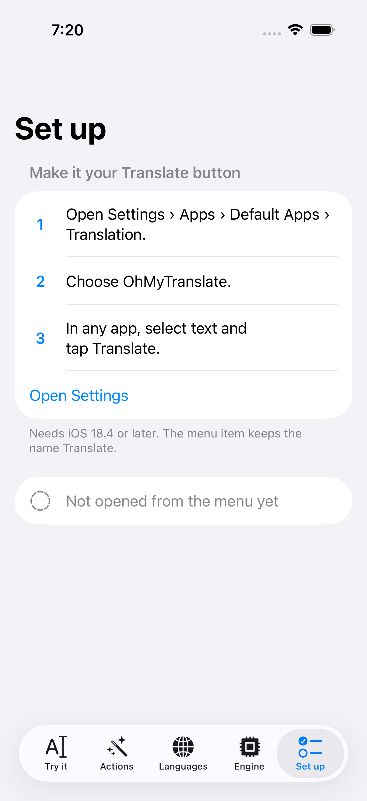

# App gallery

Screenshots from the UI tour in `OhMyTranslateUITests`, regenerated by CI on each push to `dev/*`.
Simulator: iPhone 17 Pro, iOS 26.2.

### Try it: the app with sample text

### 02-sheet-opens-translating

### 03-sheet-language-switched

### 04-sheet-action-switched

### 05-sheet-quick-prompt-typed

### 06-sheet-quick-prompt-result

### 07-replaced-in-text

### 08-tab-actions

### 09-tab-languages

### 10-tab-engine

### 11-tab-set-up

