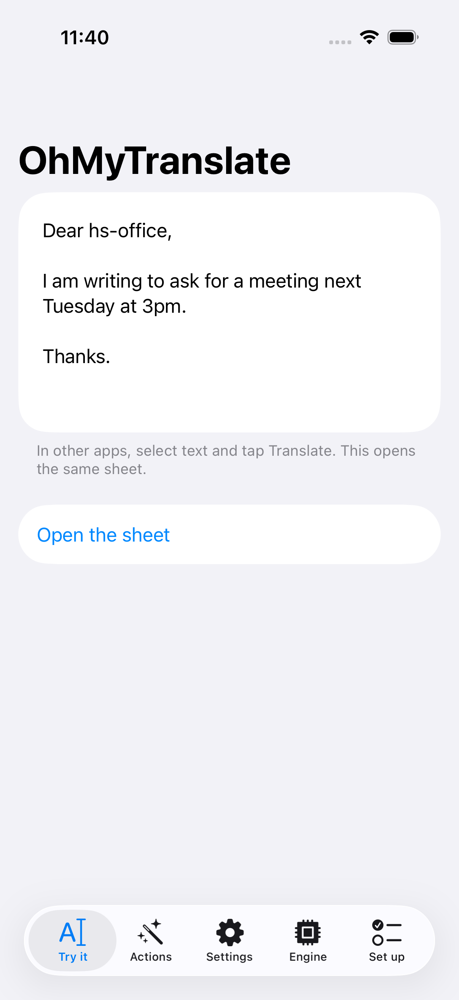
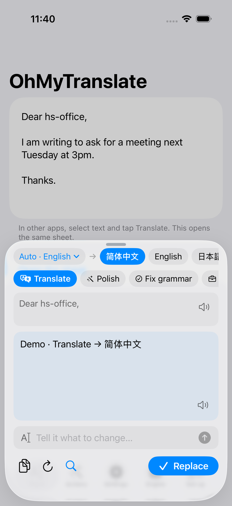
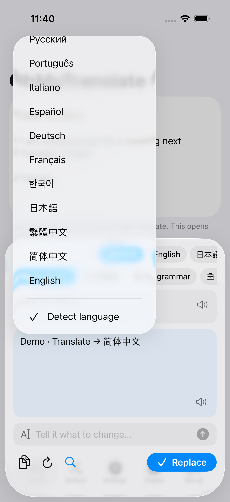
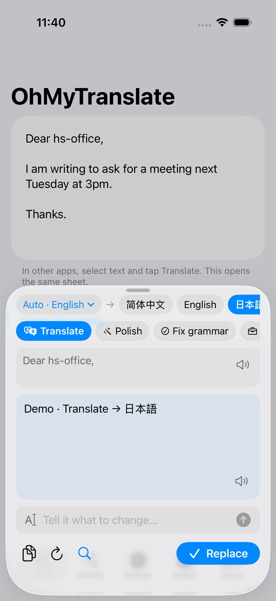
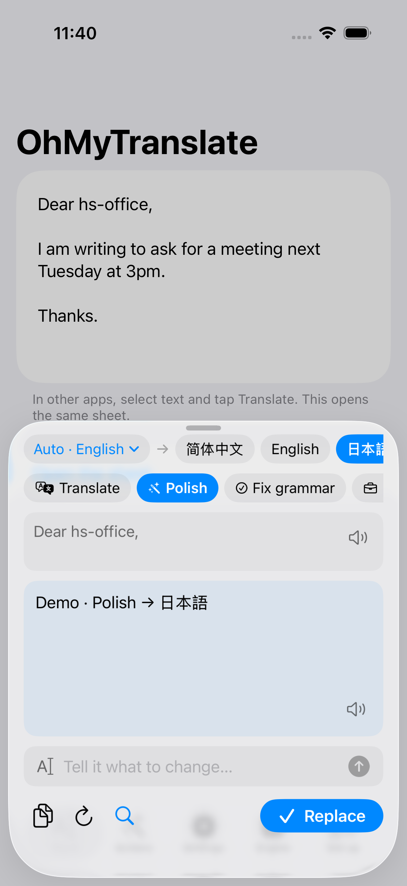
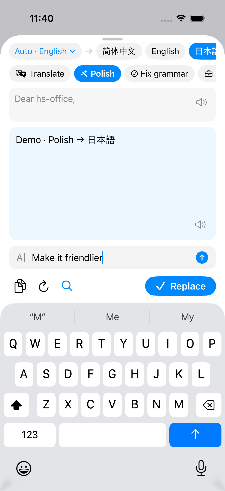
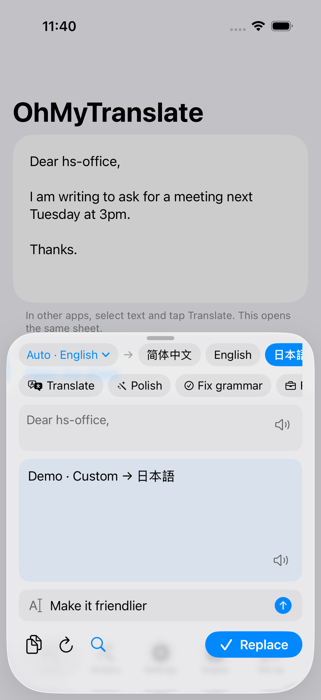
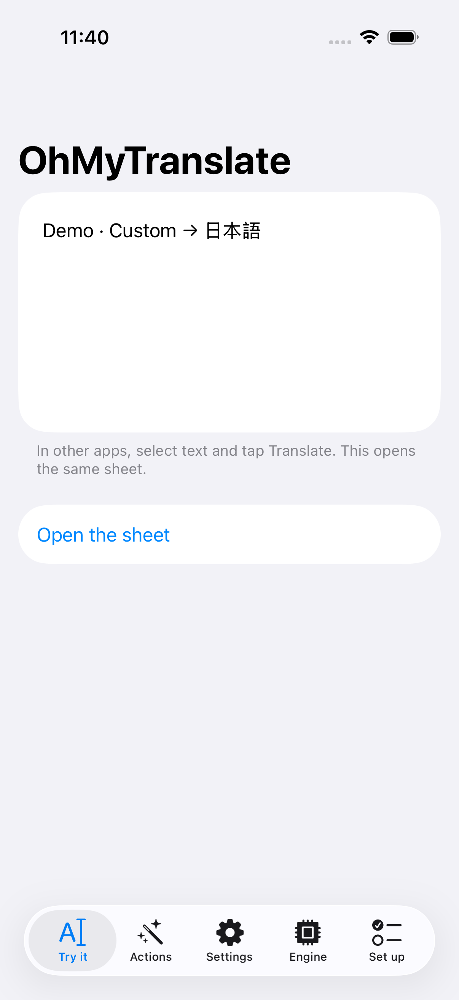
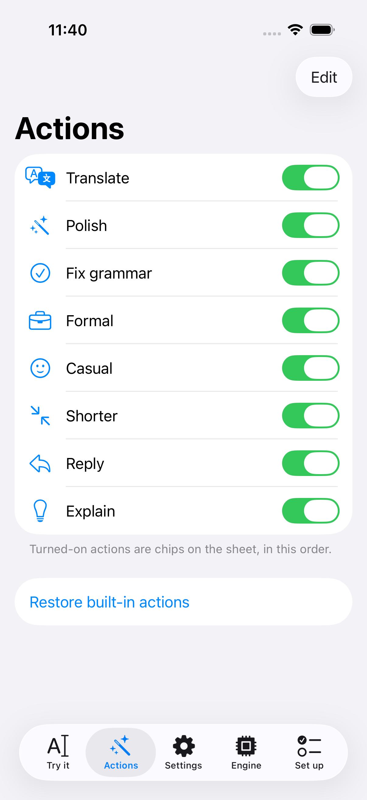
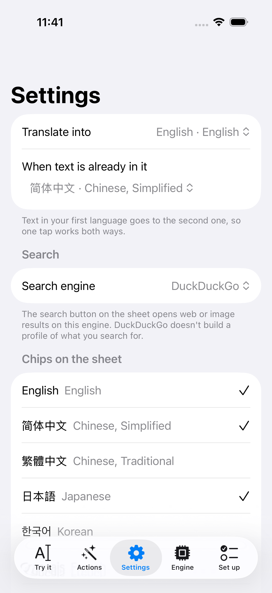

# App gallery

Screenshots from the UI tour in `OhMyTranslateUITests`, regenerated by CI on each push to `dev/*`.
Simulator: iPhone 17 Pro, iOS 26.2.

### Try it: the app with sample text

### Translate opens the sheet, language detected

### Source language: detect, or pick one

### Tap a language: it runs again

### Tap an action: Polish, same text

### Quick prompt: say what to change

### The quick prompt's result, streamed

### Replace writes it back into the text

### Actions: which chips show, and their order

### Settings: languages and the default search

### Engine: Claude, OpenAI-compatible, on-device or demo

### Set up: make it the default Translate

